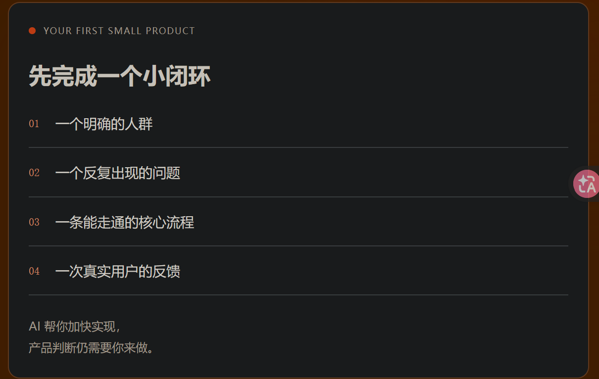
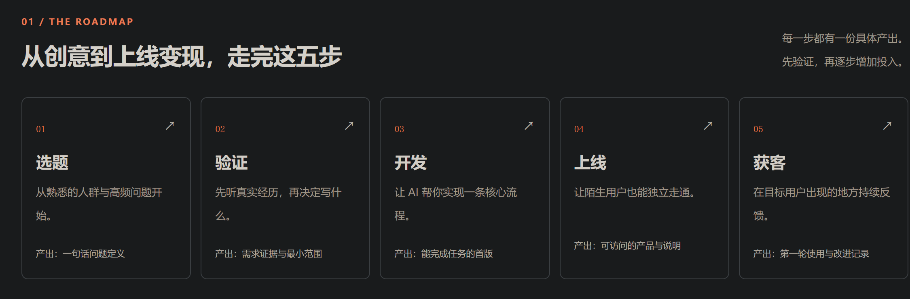

## 前言
近期都是在宣传我们的新项目，但是效果都不是很好，然后我们之前的项目也是这样，我有一些思考想要记录下来

## 一些反思
毕竟我还是抱着学习的态度做项目，一开始的我确实做得磕磕绊绊的，可以说可用性都没有多少，只不过是用上了技术；到了soniflow开始好了一些，至少有痛点，但是太过于小众，或者是频率很低，不够用心做宣传和维护；如今，AI发展迅猛，经历了实习的洗礼，以及AI工具的加持，Symbix作为我第一款比较全面和完善的开源项目，可用性也很高，我自己真的再用，但是不够吸睛，且没有解决什么痛点，或者是这个痛点都不算是个痛点。

**目前的我们其实不怎么缺技术了，缺的是一个发现痛点的眼睛**

## 所以接下来需要遵循的
首先是一个小闭环，

简单来说就是四个要素需要都具备，才有比较可能吸引到人：
1. 目标客户，你的用户群体是哪些特定的人，医生，作家或者是程序员，需要垂直一些。
2. 痛点：一定要是反复出现的，需要工具的介入，人为成本高的。
3. 可行方案：需要真的可行，比如说我们之前构想的项目，做不到既不冲击画师，又能实现精美的动画，更何况现在也没有调研到可行的技术方案。
4. 需要真实的用户反馈：需要先宣传出去，根据用户的需求来看看有无做的必要。之前有个说法是先不做，发在社交媒体上看反响是否要不要做，之前可以，但是现在肯定不行，一旦泄露自己的创意，很有可能被人剽窃，这一点如今很难验证。
**我觉得可以改为收集用户的反馈**，比如说用户对某个项目的诟病，然后刚好你做的也是类似的项目。

具体的路线：

## 结语
希望自己能做出反响好的项目！