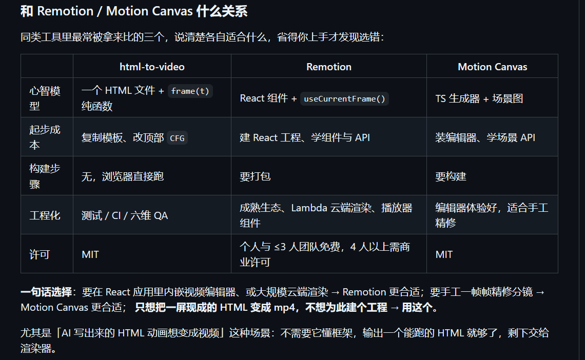

## 前言
因为在html-to-video这个项目的readme看到了，正好最近准备做这方面的项目，先了解一下

## 选择

简单来说就是remotion和motion canvas比较知名，而且似乎都有skill，比较好集成；这个html-to-video也有skill总之，也可以试试，设计理念还是不错的

## 效果
至于效果如何的，待我试完之后再说
1. remotion: 效果很好，使用了remotion skill生成，生成了项目的演示视频：
<video src="promo-landscape.mp4" controls width="600" height="400"></video>

至于其他两种的话，问了AI，简单来说，就是motion canvas适合于教学、科普向的，还有一个motion，也是倾向于简单动画制作，如果要有可能能画手书，似乎remotion最成熟，当然我还没有都试过

